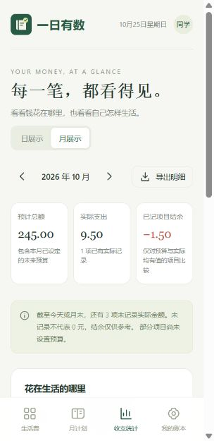

# 双衡 · 大学生生活管理

大学生生活管理工具，提供安卓 APK 和手机网页版本。安卓包内置账本页面，安装后可离线使用，不需要 Google Play 服务。

**[下载安卓版 APK](https://github.com/mik1e80/College-Student-Life-Management-Tool/releases/download/v1.5.0/yiri-1.5.0.apk)** · [GitHub 版本页面](https://github.com/mik1e80/College-Student-Life-Management-Tool/releases/tag/v1.5.0) · Android 8.0 及以上、可正常工作的现代系统 WebView。

1.5.0 更名为「双衡」，使用全新黑白图标与白底、黑字、黑色按钮。保留自由时间绿色、未规划红色和收支差值颜色。沿用原签名，直接覆盖安装，旧账本与时间安排保留。

**[打开双衡](https://campus-life-yiri-20261025.my-team-1261.chatgpt.site)** · 公开访问，无需登录。手机安装说明见 [使用说明](docs/usage.md)。

安卓安装：用手机浏览器下载 `.apk`，在下载列表中打开，按系统提示安装。「Source code」压缩包是源码，不是安装包。网页与安卓应用的账本分别保存，不会自动迁移。

## 本地运行

需要 Node.js 22 或更新版本。在本目录执行：

```text
node server.mjs
```

打开 http://localhost:4173 。本地地址用于电脑开发；手机安装请使用已发布的 HTTPS 地址。

```text
node --test tests/*.test.mjs
```

## 已实现

- 按日期独立的 24 小时时间规划、复制昨天、跨日、预置名称、自定义自由时间、重叠校验和修改删除。

- 八个初始大类，餐饮自带早、午、晚餐。三列九宫格排列，可添加和改名；没有实际记录的分类可删除，有记录（含 0 元）时保留。
- 每项选择按天、月或年设置预算与实际；月预算每月独立，年预算同年共用。
- 金额以整数分存储；未设置、未记录和 0 元分别处理。
- 本期金额可修改，按天次日锁定、按月下月锁定、按年次年锁定；历史空缺只可补录一次。
- 预计与实际上下排列，差值使用绿色正数、红色负数和默认颜色零值；下半部日历可查看历史。
- 日/月/年展示、分类汇总和支出图；月、年金额按周期生效天数折算，避免重复计费。CSV 每周期只导出一行。
- 本机存储、跨窗口保存协调、JSON 完整备份和 CSV 明细导出。
- 离线缓存、手机响应式布局、安装清单与应用图标。

## 数据与边界

网页版数据保存在当前浏览器的 localStorage，键为 `yiri-campus-life-v1`。安卓版同时使用应用私有的同步原子账本文件，WebView 存储作为镜像；重启选择更新版本，旧版账本自动兼容。没有云同步或账号服务。清理浏览器数据会丢失账本；完整 JSON 可导出，但本版本不提供导入。手机安装可能使用独立存储，安装后应确认原数据是否可见。

按本机日期决定当天，前台每 15 秒以及恢复到前台时检查跨日；保存时使用最新日期复核。锁定由个人设备应用执行，不能阻止用户手动修改存储或设备时钟。跨浏览器或跨设备的严格不可篡改需后续增加服务端。

当前月首次制定计划从当天生效，之前的预算显示未设置。未来月份单独制定，未自动沿用上月。分类只能从创建日开始记账。统计不把未记金额视为零；未设预算的支出计入实际总额，但不计入预算差值。

原对话助手计划正文未能从引用中取出，本版依据可读取的用户需求、最终确认及三张附图实现。云同步暂留后续。

## 发布

`.openai/hosting.json` 保存 Sites 项目身份。`dist/` 为部署内容；`scripts/make-icons.mjs` 可重新生成 PNG 图标。更新静态资源后同步更新 `dist/sw.js` 的缓存版本。

## 开发文档

- [需求与验收规则](docs/requirements.md)
- [手机使用说明](docs/usage.md)
- [时间管理说明](docs/time-management.md)
- [安卓构建与发行](docs/android.md)
- [数据结构与实现](docs/architecture.md)
- [开发过程记录](docs/development-log.md)
- [验证记录](docs/verification.md)
- [发布记录](docs/deployment.md)
- [版本变更](CHANGELOG.md)
- [安卓版 1.1.0 发行说明](docs/releases/v1.1.0.md)
- [安卓版 1.2.0 发行说明](docs/releases/v1.2.0.md)
- [安卓版 1.2.1 发行说明](docs/releases/v1.2.1.md)
- [安卓版 1.3.0 发行说明](docs/releases/v1.3.0.md)
- [安卓版 1.4.0 发行说明](docs/releases/v1.4.0.md)
- [安卓版 1.4.1 发行说明](docs/releases/v1.4.1.md)
- [安卓版 1.5.0 发行说明](docs/releases/v1.5.0.md)

## 界面预览

以下是本地人工测试数据，不是预置账单。

 
